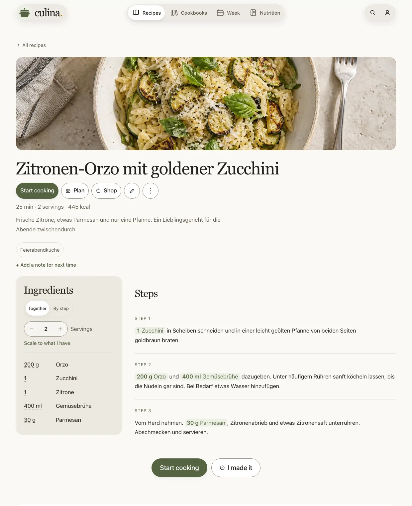

# Culina


A self-hosted kitchen companion for German-speaking households — recipe library, weekly meal planner, smart shopping list, step-by-step cooking mode, nutrition diary, and native iOS/macOS app in one container.



## Features

- **Recipe library & search** — Hybrid bilingual search (DE/EN) with prefix matching, typo tolerance, culinary synonym expansion, and filter tokens (`#tag`, `@zutat`, `~30m`, `!allergen`, `k:600`). Import via URL (`schema.org/Recipe` JSON-LD / Microdata), photos/PDFs, text, Paprika (`.paprikarecipes`), Nextcloud Cookbook, Mealie, Tandoor, or full ZIP archives.
- **Cookbooks & shared households** — Organise recipes into manual or rule-based smart cookbooks (`SmartFilterQuery`). Invite household members (`view` / `edit` / `manage`) or share read-only public links. Connect partner libraries across instances.
- **Woche (weekly planner) & Tagebuch (nutrition diary)** — Drag-and-drop 7-day meal planner (`Frühstück`, `Mittag`, `Abend`, `Snack`, `Vorbereitung`) with automatic ingredient availability checks and leftover prompts. Log meals, barcode scans (Open Food Facts + BLS 4.0), freeform entries, weight, and water against BMR/TDEE targets.
- **Smart shopping list** — Consolidates planned meals and manual items into a real-time SSE-synced list sorted by supermarket aisle, merging compatible units (`g`/`kg`, `ml`/`l`, `TL`/`EL`) and subtracting stocked pantry items (`Küche`).
- **Step-by-step cooking mode & Olli** — Distraction-free cooking view with Wake Lock, concurrent step timers, hands-free voice readout (Web Speech API / native TTS), per-portion scaling (`0.25`–`50`), and **Olli**, an optional context-aware kitchen assistant (`Cmd/Ctrl+K`) and remote MCP server (`/mcp`).
- **Web & native apps** — Installable PWA plus Capacitor 8 iOS & macOS (Mac Catalyst) app with biometric passkeys, native barcode scanner, offline recipe/shopping cache, and App Shortcuts / Spotlight indexing.

## Quickstart (Docker Compose)

Save as `compose.yaml`:

```yaml
services:
    culina:
        image: ghcr.io/jakobpriesner/culina:latest
        container_name: culina
        restart: unless-stopped
        ports:
            - "8080:8080"
        environment:
            POSTGRES_PASSWORD: ${POSTGRES_PASSWORD:?Set POSTGRES_PASSWORD in .env}
            CULINA_JWT_SECRET: ${CULINA_JWT_SECRET:?Set CULINA_JWT_SECRET in .env}
            CULINA_SETTINGS_ENCRYPTION_KEY: ${CULINA_SETTINGS_ENCRYPTION_KEY:?Set CULINA_SETTINGS_ENCRYPTION_KEY in .env}
            CULINA_PUBLIC_ORIGIN: ${CULINA_PUBLIC_ORIGIN:-http://localhost:8080}
        volumes:
            - culina-pgdata:/var/lib/postgresql/data
            - culina-uploads:/app/uploads

volumes:
    culina-pgdata:
    culina-uploads:
```

Generate secrets and start:

```bash
cat <<EOF > .env
POSTGRES_PASSWORD=$(openssl rand -hex 24)
CULINA_JWT_SECRET=$(openssl rand -base64 48 | tr -d '\n')
CULINA_SETTINGS_ENCRYPTION_KEY=$(openssl rand -base64 32 | tr -d '\n')
CULINA_PUBLIC_ORIGIN=http://localhost:8080
EOF
chmod 600 .env
docker compose up -d
```

Open `http://localhost:8080`. The first account registered becomes the instance owner.

> **Production HTTPS:** Set `CULINA_PUBLIC_ORIGIN=https://culina.example.com` and `CULINA_FORWARDED_HEADERS_KNOWN_PROXIES` behind a reverse proxy. WebAuthn passkeys and Secure cookies require matching origins.

## AI Provider Setup (Optional)

Intake extraction, Olli, and photo nutrition estimation work with any supported provider configured globally via environment variables or per-household under **Einstellungen → KI-Assistent**:

| Provider             | Key / URL Variable          | Default Model (`fast` / `capable`)                              |
| -------------------- | --------------------------- | --------------------------------------------------------------- |
| **Anthropic Claude** | `CULINA_ANTHROPIC_API_KEY`  | `claude-haiku-4-5` / `claude-sonnet-4-6`                        |
| **Google Gemini**    | `CULINA_GEMINI_API_KEY`     | `gemini-3-flash-preview` / `gemini-3.1-pro-preview`             |
| **OpenAI**           | `CULINA_OPENAI_API_KEY`     | `gpt-5.4-mini` / `gpt-5.4`                                      |
| **OpenRouter**       | `CULINA_OPENROUTER_API_KEY` | `google/gemini-3-flash-preview` / `anthropic/claude-sonnet-4-6` |
| **Ollama (local)**   | `CULINA_OLLAMA_BASE_URL`    | `gemma4:e4b`                                                    |

External AI agents (Claude Desktop, Claude Code, Cursor) can also connect directly to Culina's built-in **MCP server** at `<origin>/mcp` via OAuth 2.1 + PKCE or personal access tokens (`culina_pat_...`).

## Local Development

**Prerequisites:** .NET 10 SDK, Node.js 24 LTS + `pnpm` 10, PostgreSQL 17 (or Docker).

```bash
# 1. Start PostgreSQL + SearXNG
docker compose -f compose.dev.yaml up -d db searxng

# 2. Run backend API (http://localhost:5180, auto-migrates on boot)
dotnet run --project src/backend/Culina.Api

# 3. Run frontend dev server (http://localhost:5173)
pnpm --dir src/frontend install
pnpm --dir src/frontend dev
```

Verify changes:

```bash
dotnet test src/backend/Culina.slnx
pnpm --dir src/frontend check && pnpm --dir src/frontend test:unit
```

## Documentation

| Guide                                                               | Contents                                                                 |
| ------------------------------------------------------------------- | ------------------------------------------------------------------------ |
| [`docs/configuration.md`](docs/configuration.md)                    | Environment variables, defaults, reverse proxy & Prometheus setup        |
| [`docs/operations.md`](docs/operations.md)                          | Install, upgrades, backup/restore, key rotation, alerts, troubleshooting |
| [`docs/deployment.md`](docs/deployment.md)                          | Container topology, Dockerfile hardening, CI/CD, EF Core migrations      |
| [`docs/api.md`](docs/api.md)                                        | REST endpoints, auth/CSRF, RFC 9457 problem codes, MCP server (`/mcp`)   |
| [`docs/domain-model.md`](docs/domain-model.md)                      | Entities, ownership axes, scaling, shopping merge, connected libraries   |
| [`docs/design-system.md`](docs/design-system.md)                    | Warm Modernism tokens, typography, surfaces, motion, and components      |
| [`docs/search-design.md`](docs/search-design.md)                    | Hybrid Postgres FTS + trigram search, query grammar, ranking tiers       |
| [`docs/suggestions-research.md`](docs/suggestions-research.md)      | Contextual meal suggestion engine, decay curves, MMR diversity           |
| [`docs/nutrition-design.md`](docs/nutrition-design.md)              | BLS 4.0 + Open Food Facts pipeline, Retention factors, BMR/TDEE          |
| [`docs/native-app-design.md`](docs/native-app-design.md)            | Capacitor 8 iOS & Mac Catalyst architecture, plugins, offline sync       |
| [`CONTRIBUTING.md`](CONTRIBUTING.md) · [`SECURITY.md`](SECURITY.md) | Contribution workflow, coding conventions, and vulnerability reporting   |

## License

MIT — see [`LICENSE`](LICENSE).
